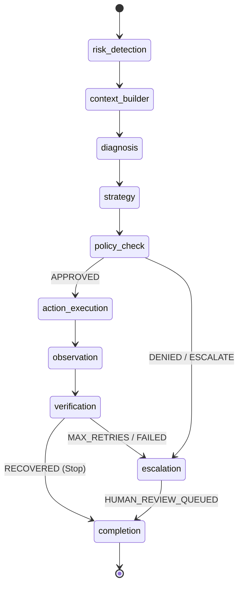

# Agent Architecture & Safety Boundaries — RevenueRescue AI

## 1. Core Architectural Principle

```text
    AI PROPOSES
         ↓
    POLICY AUTHORIZES   (Deterministic, Policy Engine, LLM cannot touch)
         ↓
    EXECUTOR ACTS       (Only on APPROVED actions, in simulation/test mode)
         ↓
    SYSTEM OBSERVES     (Payment / Mandate / Checkout Simulator)
         ↓
    VERIFIER CONFIRMS   (Authoritative transaction state from DB/Simulator)
         ↓
    STOP / REPLAN / ESCALATE
```

The system strictly enforces this boundary:
- **The LLM is a reasoning engine, not an authority.** It diagnoses decline codes, predicts user context, and suggests actions.
- **The Policy Engine is deterministic.** It evaluates merchant invariants, retry counts, timing windows, customer consent, and monetary limits.
- **The Recovery Verifier is authoritative.** Only transaction state emitted by the payment provider/simulator can transition a case to `RECOVERED`. An LLM output claiming recovery has zero authoritative effect.

---

## 2. LangGraph 10-Node State Machine

The recovery lifecycle is modeled as a deterministic LangGraph state machine:



### Node Specifications:

| Node | Responsibility | Execution Mode | Fallback / Guardrail |
| :--- | :--- | :--- | :--- |
| **`risk_detection`** | Ingests event payload, validates idempotency key and schema. | Deterministic Python | Rejects malformed events with HTTP 422. |
| **`context_builder`** | Loads customer segment, historical attempts, and calls `MLScoringService`. | Deterministic DB/Python | Falls back to rule heuristic if ML artifact missing. |
| **`diagnosis`** | Analyzes failure reason, payment method, and error code. | LLM (DeepSeek / Mock) | `LocalDeterministicProvider` falls back on failure/timeout. |
| **`strategy`** | Proposes action type (e.g. `SCHEDULE_RETRY`, `CHECKOUT_RECOVERY`, `UPDATE_METHOD`). | LLM (DeepSeek / Mock) | Bounded to predefined action enums. |
| **`policy_check`** | Validates action against merchant policy rules. | Deterministic Python | **Non-negotiable.** Denies unapproved actions. |
| **`action_execution`**| Dispatches approved recovery action to simulator or test provider. | Deterministic Provider | Only runs if `decision == APPROVED`. |
| **`observation`** | Records simulator attempt result or provider callback. | Deterministic Provider | Logs attempt to append-only database ledger. |
| **`verification`** | Inspects transaction state to verify actual fund receipt. | Deterministic Verifier | Authoritative check. Marks `RECOVERED` or `FAILED`. |
| **`escalation`** | Handles blocked actions, unknown errors, and high-value anomalies. | Deterministic Queue | Assigns to human operator review queue. |
| **`completion`** | Emits audit events, updates state machine, and releases lock. | Deterministic Audit | Appends immutable audit trail entry. |

---

## 3. ML Scoring Service Integration

The ML model (`rr-lightgbm.v1` / `rr-hybrid.v1`) is invoked in `context_builder` via `backend/app/services/ml_scoring_service.py`.

```python
score_result = ml_scoring_service.predict_probability(features)
recovery_prob = score_result.probability
expected_value_paise = ml_scoring_service.calculate_expected_value(
    amount_paise=event.amount_paise,
    recovery_probability=recovery_prob,
    intervention_cost_paise=50,  # e.g., ₹0.50 SMS / webhook cost
)
```

### Safety Rules for ML Predictions:
1. **Never treated as authorization:** A model predicting 99% probability cannot execute a retry if the policy retry limit (max 3) is reached.
2. **Never treated as recovery:** A case cannot be marked `RECOVERED` because of a high score; only the Verifier reading payment capture can confirm it.
3. **Safe degradation:** If the model file is corrupt or missing, `MLScoringService` logs a warning and falls back to deterministic rule scoring without crashing the agent.
